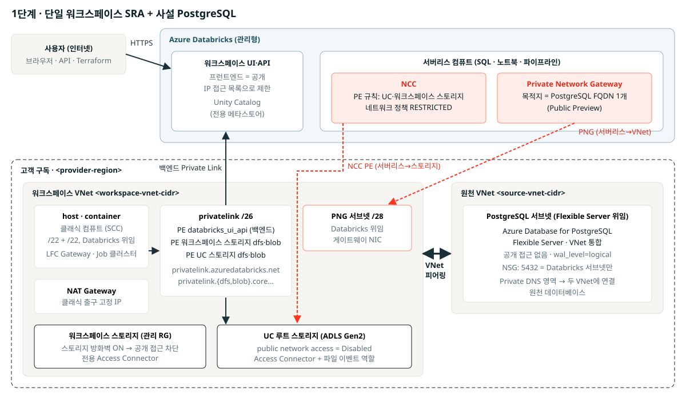
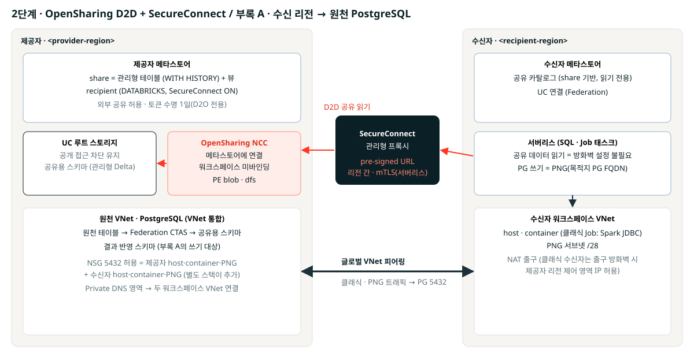

# Azure Databricks 단일 워크스페이스 SRA · 사설 PostgreSQL CDC · OpenSharing D2D 구성 가이드

> 기준일 2026-11-12 · Terraform 1.5+, azurerm 5.12, databricks provider 1.141
> 이 리포지토리의 Terraform 코드(`modules/`, `envs/`, `samples/`)를 기준으로 씁니다. 공식 Databricks SRA가 아닌 **비공식 예제**입니다. 환경마다 다른 값은 `<자리표시자>`로 적었습니다. 제품 상태(GA·Preview)와 제약은 기준일의 Microsoft Learn 문서를 따릅니다.

## 개요

### 목표

| 단계 | 내용 |
|---|---|
| 1단계 | 리전마다 SRA(Security Reference Architecture, 보안 참조 아키텍처) 원칙의 워크스페이스를 배포합니다. **프런트엔드만 공개**하고 **백엔드와 스토리지는 모두 사설**로 둡니다. 제공자 리전에는 별도 VNet의 사설 PostgreSQL을 두고, Lakeflow Connect(LFC) PostgreSQL CDC(Change Data Capture, 변경 데이터 캡처)로 수집합니다. |
| 2단계 | OpenSharing Databricks-to-Databricks(D2D) 방식으로 제공자 리전 → 수신자 리전 공유를 구성합니다. 제공자 스토리지는 **사설 상태를 유지**하고, SecureConnect로 리전 간 접근을 중개합니다. |
| 부록 A | 수신자 리전에서 제공자 리전의 사설 PostgreSQL에 보안 접근합니다(조회 연결, Lakeflow Job에서 PostgreSQL로 결과 반영). |
| 부록 B~F | 운영·정리, 서버리스 → 사설 PostgreSQL 연결 옵션, 설계 근거(SRA 대응), Integrated CDC 전환 참고, 참고 문서 |

공식 SRA Terraform(Hub-Spoke 전제)과 이 가이드 구성의 차이는 부록 D에 정리했습니다. 요약하면 **단일 워크스페이스, Hub 없음, 출구는 NAT Gateway, CMK·ESC·SAT는 범위 제외**입니다.

### 전체 구성도





## 0 · 준비

### 0.1 리포 구성

| 경로 | 내용 | 사용 |
|---|---|---|
| `modules/azure-databricks-hardened` | 워크스페이스 공통 모듈 (VNet·NSG·NAT, 백엔드·스토리지 PE, NCC·네트워크 정책, 전용 메타스토어, PNG(Private Network Gateway, 사설 네트워크 게이트웨이)) | 스택 2개가 호출 |
| `envs/sra-provider` | 제공자 리전 워크스페이스 | 필수 |
| `envs/sra-recipient` | 수신자 리전 워크스페이스 (`sra-provider`와 같은 코드, 값만 다름) | 필수 |
| `envs/pg-source` | 원천 VNet + PostgreSQL Flexible Server + 피어링 + Private DNS | **샘플 원천**. 이미 있는 PostgreSQL을 쓰면 생략 |
| `envs/pg-png-access` | PostgreSQL NSG에 제공자 PNG 서브넷 → 5432 허용 규칙 1개 | 서버리스 → PostgreSQL이 필요할 때 |
| `envs/lfc-pg-cdc` | 대상·스테이징 스키마, UC 연결, LFC Gateway·수집 파이프라인, 예약 Job. 샘플 원천이면 적재·원천 설정 Job도 | 필수 |
| `envs/opensharing` | OpenSharing NCC·PE, share, recipient, 수신 카탈로그 | 필수 |
| `envs/recipient-pg-access` | 리전 간 피어링, DNS 링크, NSG 규칙, 수신자 측 UC 연결, 쓰기 Job | 부록 A |
| `samples/adventureworks-pg` | Microsoft 샘플 OLTP 16개 테이블을 PostgreSQL에 적재하고 원천을 설정하는 노트북 | `pg-source`를 쓸 때 |
| `samples/opensharing` | 공유 데이터 준비 노트북, PostgreSQL 쓰기 노트북 | 2단계, 부록 A |

**스택 공통 사항**

- 각 스택에서 `terraform.tfvars.example`을 `terraform.tfvars`로 복사해 값을 채웁니다. 기본 명령은 아래와 같습니다.

```bash
cd envs/<stack>
cp terraform.tfvars.example terraform.tfvars   # fill in
terraform init
terraform plan -out tfplan && terraform apply tfplan
```

- 스택마다 state를 따로 두고, 스택끼리는 `terraform_remote_state`로 출력값을 넘겨받습니다. 기본 경로는 `../<stack>/terraform.tfstate`이고, `*_state_path` 변수로 바꿉니다.
- `pg-png-access`와 `recipient-pg-access`는 **PostgreSQL 스택을 고치지 않고** PostgreSQL 쪽 네트워크 객체(NSG 규칙, 피어링, DNS 링크)를 별도 리소스로 추가합니다. "DB 소유 팀에 요청할 변경"을 분리해 둔 것이고, PostgreSQL 스택의 plan에 drift가 생기지 않습니다.
- **이미 있는 PostgreSQL을 쓰는 경우:** `pg-source`를 건너뛰고, 다른 스택에서 `pg_state_path = null`로 둔 뒤 `pg_*` 변수(접속 정보, 리소스 그룹·VNet·서브넷·NSG·Private DNS 영역 이름)를 넣습니다. 각 스택의 `terraform.tfvars.example`에 예시가 있습니다.

### 0.2 자리표시자

| 자리표시자 | 의미 |
|---|---|
| `<provider-region>` | 제공자 워크스페이스와 PostgreSQL이 있는 리전 (예: `koreacentral`) |
| `<recipient-region>` | 수신자 워크스페이스 리전 |
| `<prefix>` | 스택별 이름 접두사 (예: `sra-provider`) |
| `<workspace-vnet-cidr>` | 워크스페이스 VNet. host·container 각 /22, privatelink /26, PNG /28을 담을 수 있는 크기(예: /20) |
| `<png-subnet-cidr>` | 워크스페이스 VNet 안의 PNG 서브넷 /28 |
| `<source-vnet-cidr>` | PostgreSQL VNet. 두 워크스페이스 VNet과 겹치지 않게 잡습니다 |
| `<pg-fqdn>` | PostgreSQL 서버 FQDN(Fully Qualified Domain Name, 전체 도메인 이름) (`<server>.postgres.database.azure.com`) |
| `<catalog>` | 수집 대상 카탈로그 |
| `<share>` · `<recipient>` | OpenSharing share와 recipient 이름 |
| `<connection>` | UC 연결 이름 |

### 0.3 사전 요건

- Azure: 구독 Owner(또는 Contributor + User Access Administrator). NCC(Network Connectivity Configuration, 서버리스 네트워크 연결 구성) PE(Private Endpoint, 사설 엔드포인트)를 승인하려면 **구독 범위**에 `privateEndpointConnectionsApproval` 권한이 필요합니다. 관리 리소스 그룹에는 deny assignment가 걸려 있어 그 리소스 그룹에는 역할을 줄 수 없습니다.
- 구독에 `Microsoft.EventGrid` 리소스 공급자 등록 (UC 파일 이벤트용)
- Databricks: 계정 관리자(NCC·네트워크 정책·메타스토어), 메타스토어 관리자(share·recipient)
- 계정 Previews: **Private Network Gateway**(Public Preview)를 켭니다.
- SecureConnect: GA이며 Premium 계정에서는 기능이 기본으로 켜져 있습니다. 계정 Previews에 SecureConnect 토글이 없으면 이미 켜진 상태입니다. 다만 **recipient는 기본적으로 SecureConnect에 등록되지 않으므로** 메타스토어 설정이나 recipient별 토글로 켭니다(2.4 C).
- LFC PostgreSQL 커넥터: Public Preview입니다. **워크스페이스별 등록**을 담당 어카운트팀에 요청합니다. 등록 전에는 파이프라인 생성이 `Ingestion source 'POSTGRESQL' is not supported in your workspace`로 거부됩니다.
- LFC Gateway를 만드는 사용자: 클러스터 생성 권한(제한 없음) 또는 문서가 정한 형식의 Gateway용 컴퓨트 정책(Job Compute 계열, API 전용)
- 로컬 도구: Terraform, Azure CLI(`az login`), Databricks CLI(계정 프로필, 워크스페이스는 Azure CLI 인증), bash(PE 승인 스크립트)

### 0.4 state와 비밀값 보호

- state에는 PostgreSQL 관리자·복제 사용자 비밀번호, secret 값이 **평문으로** 저장됩니다. `sensitive = true`는 plan·apply 화면 출력만 가립니다. 저장된 plan 파일(`tfplan`)도 마찬가지입니다.
- 이 리포의 `backend.tf`는 local입니다. 운영에서는 접근을 제한한 원격 backend(Azure Storage, 사설 엔드포인트, RBAC(역할 기반 접근 제어) 최소 권한, 암호화)로 바꾸고, `terraform_remote_state`도 같은 backend를 가리키게 바꿉니다. `.gitignore`는 `*.tfstate`·`*.tfvars`·`tfplan`을 제외합니다.
- 비밀번호를 tfvars 파일에 쓰지 않으려면 `TF_VAR_<변수명>` 환경 변수로 넘깁니다(`pg_connection`, `pg_reader`, `pg_writer`).
- secret scope에는 그 secret을 읽어야 하는 사용자·서비스 주체에만 `READ`를 줍니다. 샘플 적재·원천 설정 Job이 쓰는 관리자 secret은 `<scope>-admin`으로 나뉘어 있고, 데모가 끝나면 `enable_sample_jobs = false`로 apply해 지웁니다.
- 참고: [Terraform – Sensitive data in state](https://developer.hashicorp.com/terraform/language/state/sensitive-data) · [azurerm backend](https://developer.hashicorp.com/terraform/language/backend/azurerm) · [Secret management](https://learn.microsoft.com/azure/databricks/security/secrets/)

### 0.5 전체 실행 순서

스택 순서가 한 방향이 아닙니다. 워크스페이스는 PostgreSQL FQDN이 정해진 뒤 PNG 설정으로 **다시 apply**하고, 2단계는 Terraform과 UI 단계를 번갈아 진행합니다.

| # | 위치 | 작업 | 확인 | 절 |
|---|---|---|---|---|
| 1 | `envs/sra-provider` | 1차 apply (`workspace_url` 없이) | `workspace_url` 출력 | 1.2 |
| 2 | `envs/sra-provider` | 2차 apply (`runtime.auto.tfvars`에 `workspace_url`) | 1.3 확인 표 | 1.2 |
| 3 | `envs/sra-recipient` | 1차·2차 apply | 1.3 확인 표 | 1.2 |
| 4 | `envs/pg-source` | 샘플 원천 PostgreSQL (기존 DB면 생략) | `pg_fqdn` 출력 | 1.6 |
| 5 | `envs/sra-provider` | PNG 설정(`png_destinations = [<pg-fqdn>]`)으로 재apply | PNG 생성 | 1.7 |
| 6 | `envs/pg-png-access` | PostgreSQL NSG에 PNG 서브넷 허용 | `remote_query`로 사설 IP | 1.7 |
| 7 | `envs/lfc-pg-cdc` | `enable_ingestion = false` apply → 적재·원천 설정 Job 실행 (기존 DB는 DB 팀이 원천 설정) | Job 성공, 슬롯 생성 | 1.8 |
| 8 | `envs/lfc-pg-cdc` | `enable_ingestion = true` apply (+ 예약) | 대상 테이블 행 수 | 1.9 |
| 9 | 제공자 워크스페이스 | 조회용 UC 연결·foreign catalog → 공유 데이터 준비 노트북 | 공유용 스키마 | 2.3 |
| 10 | `envs/opensharing` | A: OpenSharing NCC·PE, share | PE 승인 | 2.4 |
| 11 | 계정 콘솔 · 제공자 워크스페이스 UI | B: 메타스토어 OpenSharing 설정, C: SecureConnect 기본 적용 | - | 2.4 |
| 12 | `envs/opensharing` | D: `enable_recipient = true` | recipient 생성 | 2.4 |
| 13 | `envs/opensharing` | E: `recipient_provider_name` | 수신 카탈로그 조회 | 2.4·2.5 |
| 14 | `envs/sra-recipient` | (부록 A) PNG 설정으로 재apply | PNG 생성 | A.3 |
| 15 | `envs/recipient-pg-access` | (부록 A) 피어링·DNS·NSG·연결·쓰기 Job | 쓰기 Job 두 태스크 성공 | A.3·A.4 |

## 1단계 · SRA 워크스페이스와 사설 PostgreSQL CDC

### 1.1 워크스페이스 스택 (`envs/sra-provider`, `envs/sra-recipient`)

**입력 변수 (`terraform.tfvars`)**

| 변수 | 내용 |
|---|---|
| `subscription_id`, `tenant_id`, `location` | 배포 구독과 리전 |
| `resource_group_name`, `prefix`, `workspace_name`, `tags` | 이름과 태그 (Azure 태그 이름은 대소문자를 구분하지 않으므로 `owner`와 `Owner`를 함께 쓰지 않습니다) |
| `vnet_cidr`, `subnet_cidrs` | 워크스페이스 VNet과 host·container·privatelink 서브넷 |
| `databricks_account_id`, `databricks_account_profile` | 계정 ID와 계정 프로필 (`~/.databrickscfg`) |
| `catalog_name` | 2차 apply에서 만드는 시작 카탈로그 |
| `client_allowed_cidrs` | 워크스페이스 IP 접근 목록 (2차 apply) |
| `metastore_delta_sharing` | 제공자만: OpenSharing 범위 (2.4 B) |
| `enable_private_network_gateway`, `png_subnet_cidr`, `png_destinations` | 서버리스 → 사설 PostgreSQL (1.7, 부록 A) |
| `uc_storage_bypass_azure_services` | UC 스토리지 방화벽의 신뢰 서비스 예외. 운영은 `false` 권장 (아래) |

**스택이 모듈에 고정해 넘기는 값**

| 모듈 변수 | 값 | 설명 |
|---|---|---|
| `public_network_access_enabled` | `true` | 프런트엔드 공개. 사용자 접근은 IP 접근 목록으로 제한 |
| `workspace_storage_firewall_enabled` | `true` | DBFS(Databricks File System) 루트 스토리지 방화벽 + 전용 Access Connector + dfs·blob PE + NCC PE(승인 스크립트) |
| `uc_storage_public_network_access_enabled` | `false` | UC 루트 스토리지 공개 접근 차단 |
| `uc_storage_private_endpoints_enabled` | `true` | 클래식 컴퓨트용 UC 스토리지 PE |
| `uc_file_events_roles_enabled` | `true` (모듈 기본값) | Access Connector에 파일 이벤트 역할 부여(1.4) |
| `network_policy_restriction_mode` | `RESTRICTED_ACCESS` | 서버리스 출구 허용 목록(필요한 FQDN + PNG 목적지) |
| `create_workload_subnets` | `false` | Databricks 전용 VNet. 워크로드는 별도 VNet에 두고 피어링 |
| `disable_legacy_access` | `true` (변수 기본값) | 2차 apply에서 적용 |

UC 스토리지의 공개 접근을 막으면 Terraform 실행 위치에서 스토리지 데이터 평면에 닿지 않습니다. 그래서 스택의 azurerm provider에 다음 설정이 들어 있습니다.

```hcl
provider "azurerm" {
  features {
    storage {
      data_plane_available = false
    }
  }
}
```

**UC 스토리지 방화벽과 제어 영역 접근**

UC는 메타데이터 작업을 위해 Databricks 제어 영역에서 스토리지에 접근합니다. 공개 접근을 Disabled로 둔 스토리지에서는 **Access Connector의 관리 ID**로 이 접근을 허용합니다.

- 리소스 인스턴스 규칙: 스토리지 Networking › Resource instances에 `Microsoft.Databricks/accessConnectors` 유형으로 Access Connector를 등록합니다. 모듈은 `network_rules.private_link_access`로 등록합니다.
- 공개 접근 Disabled: 문서 원문은 "The managed identity can be used to bypass the check on public network access."입니다.
- 신뢰할 수 있는 서비스 예외: 문서는 리소스 인스턴스 규칙을 등록한 뒤 *Allow Azure services on the trusted services list to access this storage account*를 **해제**하도록 안내합니다. 켜 두면 같은 테넌트의 모든 Access Connector와 Azure 신뢰 서비스가 이 스토리지에 접근할 수 있습니다. 이 리포의 기본값은 예외가 켜진 상태(`uc_storage_bypass_azure_services = true`)이므로, 운영에서는 `false`로 apply한 뒤 외부 위치 Test connection과 서버리스 조회를 확인합니다.
- 참고: [Use Azure managed identities in Unity Catalog – Configure trusted access](https://learn.microsoft.com/azure/databricks/connect/unity-catalog/cloud-storage/azure-managed-identities) · [SecureConnect – Configure your storage firewall](https://learn.microsoft.com/azure/databricks/opensharing/secureconnect-provider)

**서버리스 패키지 설치 경로**

서버리스 노트북·Job에서 공용 PyPI를 쓰려면 출구 허용 목록에 `pypi.org`·`files.pythonhosted.org`를 넣습니다(`serverless_allowed_fqdns` 기본값). 사내 패키지 미러가 있으면 **기본 패키지 저장소**(Default Package Repositories)로 지정하고 공용 PyPI는 허용 목록에서 빼는 방법도 있습니다. 미러는 서버리스에서 닿아야 합니다(NCC PE, PNG 또는 허용 목록). 참고: [Configure default package repositories](https://learn.microsoft.com/azure/databricks/admin/workspace-settings/default-package-repositories)

### 1.2 배포 (1차·2차 apply)

1. **1차 apply:** `workspace_url`을 비워 둡니다. 리소스 그룹, VNet, NSG, NAT, 워크스페이스, PE, NCC, 네트워크 정책, 메타스토어, UC 스토리지가 만들어집니다. NCC PE는 스크립트(`modules/azure-databricks-hardened/scripts/approve_private_endpoints.sh`)가 대상 스토리지에서 승인합니다. 스크립트는 **이 스택의 NCC 규칙이 만든 엔드포인트의 연결만** 승인하고, 다른 대기 중 연결은 건드리지 않습니다.
2. **2차 apply:** 출력된 `workspace_url`을 `runtime.auto.tfvars`에 넣고 다시 apply합니다. IP 접근 목록, IP 접근 목록 적용, 시작 카탈로그, 레거시 기능 비활성화가 적용됩니다.

```bash
cd envs/sra-provider
terraform init && terraform plan -out tfplan && terraform apply tfplan     # 1st apply
echo "workspace_url = \"$(terraform output -raw workspace_url)\"" > runtime.auto.tfvars
terraform plan -out tfplan && terraform apply tfplan                       # 2nd apply
```

`envs/sra-recipient`도 같은 순서로 배포합니다.

> **주의:** `client_allowed_cidrs`(IP 접근 목록)에는 **Terraform을 실행하는 위치의 출구 대역**과 **사용자 접속 대역**을 모두 넣습니다. 빠뜨리면 2차 apply 직후 Terraform과 사용자가 워크스페이스에 접속하지 못합니다. VPN 출구 IP는 바뀔 수 있으니 `/32` 하나보다 대역으로 넣습니다. NAT 공인 IP는 모듈이 자동으로 추가합니다.

### 1.3 배포 후 확인

| 확인 항목 | 방법 | 기대 결과 |
|---|---|---|
| NCC PE | `databricks account network-connectivity list-private-endpoint-rules <ncc-id>` | 4개(UC·워크스페이스 스토리지 × dfs·blob) `ESTABLISHED` |
| 비공개 UC 스토리지 접근 | Catalog › 외부 위치 `metastore_root_location` › Test connection | READ·LIST·WRITE·DELETE·파일 이벤트 PASS |
| 서버리스 쓰기·읽기 | 서버리스 SQL warehouse에서 관리형 테이블 CTAS(CREATE TABLE AS SELECT) | 성공 |
| IP 접근 목록 | `databricks workspace-conf get-status enableIpAccessLists` · `databricks ip-access-lists list` | `true` · 허용 목록 `enabled = true`, 허용 대역 밖에서 접속 거부 |
| 레거시 기능 차단 | `databricks api get /api/2.0/settings/types/disable_legacy_access/names/default` | `value = true` |
| Terraform 멱등성 | 재 plan | No changes |

### 1.4 UC Access Connector의 파일 이벤트 역할

새 외부 위치(자동 생성되는 `metastore_root_location` 포함)는 **파일 이벤트가 기본으로 켜져 있습니다.** Access Connector에 다음 4개 역할을 줍니다. 모듈은 `uc_file_events_roles_enabled = true`(기본값)로 부여합니다.

| 역할 | 범위 |
|---|---|
| Storage Blob Data Contributor | UC 스토리지 계정 |
| Storage Queue Data Contributor | UC 스토리지 계정 |
| Storage Account Contributor | UC 스토리지 계정 |
| EventGrid EventSubscription Contributor | UC 스토리지가 속한 **리소스 그룹** |

> **주의:** Storage Blob Data Contributor만 주면 외부 위치 검증이 파일 이벤트 항목에서 실패하고, Auto Loader managed file events와 파일 도착 트리거를 쓸 수 없습니다. 역할을 준 뒤 전파까지 1~2분 걸립니다.

### 1.5 카탈로그 생성

- 저장 위치를 **비워 두면** metastore 루트를 씁니다(권장).
- 경로를 명시하려면 외부 위치 `metastore_root_location`을 고르고 **하위 경로**(예: `catalogs/<catalog>`)를 입력합니다.

> **주의:** metastore 루트 URL(`abfss://metastore@<account>.dfs.core.windows.net/`)을 그대로 지정하면 관리형 저장소와 겹친다는 오류로 생성되지 않습니다.

### 1.6 사설 PostgreSQL 원천 (`envs/pg-source`)

샘플 원천을 만드는 스택입니다. 이미 있는 PostgreSQL을 쓰면 건너뛰고, 아래 표의 구성을 DB 담당 팀에 요청합니다.

| 항목 | 값 |
|---|---|
| VNet | 원천 VNet `<source-vnet-cidr>`, 제공자 워크스페이스 VNet과 양방향 피어링 |
| 서브넷 | PostgreSQL 서브넷 /24, `Microsoft.DBforPostgreSQL/flexibleServers` 위임 |
| 서버 | PostgreSQL 13 이상(스택 기본 16), VNet 통합(private access), **공개 접근 없음** |
| DNS | `<prefix>.private.postgres.database.azure.com` Private DNS 영역 → 원천 VNet·워크스페이스 VNet에 연결 |
| NSG | 5432 허용 = Databricks host·container 대역만, 다른 VNet 출발 5432는 거부(우선순위 200) |
| 서버 파라미터 | `wal_level=logical`(정적 파라미터, 재시작 필요), `max_replication_slots`·`max_wal_senders` ≥ 복제할 데이터베이스 수 + 기존 사용분 |

**입력 변수:** `subscription_id`, `tenant_id`, `location`(제공자 리전), `resource_group_name`, `prefix`, `tags`, `vnet_cidr`, `pg_subnet_cidr`. 서버 SKU·버전·저장 용량은 `pg_sku_name`·`pg_version`·`pg_storage_mb`로 바꿉니다.

**출력:** `pg_fqdn`(1.7의 PNG 목적지), 관리자·복제 사용자 이름과 비밀번호(sensitive), 네트워크 객체 이름(다른 스택이 읽음)

> **주의:** Azure Database for PostgreSQL은 `max_slot_wal_keep_size`가 **-1로 고정**(읽기 전용)되어 있습니다. 복제 슬롯이 소비되지 않으면 WAL(Write-Ahead Log, 선행 기록 로그)이 상한 없이 쌓이므로 부록 B.1의 모니터링을 함께 구성합니다.

**TLS 설정**

- 클라이언트: `sslmode=verify-full`(인증서와 호스트 이름 모두 검증). Private Endpoint나 VNet 통합의 DNS 구성 때문에 호스트 이름 검증이 안 되면 `verify-ca`를 씁니다. `require`는 인증서를 검증하지 않아 Azure 문서가 "권장하지 않음"으로 분류합니다. 이 리포의 샘플 노트북은 `sslmode=require`로 접속하므로, 운영 코드에서는 `verify-full`로 바꿉니다.
- 신뢰 저장소: Azure 루트 CA(Certificate Authority, 인증 기관) 인증서(DigiCert Global Root G2, Microsoft RSA Root CA 2017)만 넣습니다. 중간 CA나 서버 인증서를 넣으면 인증서 교체 때 접속이 끊깁니다.
- 서버: `ssl_min_protocol_version = TLSv1.3`(TLS 1.2 클라이언트가 있으면 설정하지 않음)
- 참고: [TLS in Azure Database for PostgreSQL](https://learn.microsoft.com/azure/postgresql/security/security-tls)

### 1.7 서버리스에서 사설 PostgreSQL 연결 (PNG)

UI의 **Test connection**과 수집 마법사, 서버리스 SQL·노트북(2.3의 공유 데이터 준비 포함)은 서버리스에서 실행됩니다. 서버리스는 고객 VNet의 Private DNS와 피어링을 쓸 수 없고, VNet 통합 서버에는 PE를 붙일 수 없으므로 **Private Network Gateway**(PNG)를 씁니다(부록 C의 옵션 B).

1. `envs/sra-provider`에 아래 값을 넣고 다시 apply합니다. 워크스페이스 VNet에 /28 PNG 서브넷(Databricks 위임)과 게이트웨이가 생기고, 목적지는 **`<pg-fqdn>` 하나**입니다. 모듈이 `png_destinations`를 서버리스 네트워크 정책 허용 목록에도 더합니다.
2. `envs/pg-png-access`를 apply해 PostgreSQL NSG에 **PNG 서브넷 → 5432 허용**을 추가합니다(우선순위 110, 원천 스택의 거부 규칙 200보다 앞).

```hcl
# envs/sra-provider/terraform.tfvars
enable_private_network_gateway = true
png_subnet_cidr                = "<png-subnet-cidr>" # /28 inside <workspace-vnet-cidr>
png_destinations               = ["<pg-fqdn>"]       # pg_fqdn output of envs/pg-source
```

> **주의:** PNG 목적지는 접미사로 매칭되므로 `postgres.database.azure.com`처럼 넓게 잡지 않습니다. 서버리스 네트워크 정책이 PNG보다 먼저 평가되므로 허용 목록에도 같은 FQDN이 있어야 합니다(모듈이 추가). 게이트웨이를 삭제한 뒤 서브넷이 해제될 때까지 수십 분 걸릴 수 있습니다.

**확인:** UC 연결을 만든 뒤(1.9 또는 2.3) 서버리스 SQL warehouse에서 PostgreSQL 사설 IP가 나오는지 봅니다.

```sql
SELECT * FROM remote_query('<connection>', database => '<db>',
  query => "SELECT current_user, inet_server_addr()::text AS server_ip, version()");
```

> `remote_query` 안쪽 쿼리에 작은따옴표가 있으면 **바깥 문자열을 큰따옴표**로 감쌉니다. 확인에 쓰는 UC 연결도 용도별 최소 권한 사용자로 만듭니다.

### 1.8 원천 설정 (복제 사용자 · publication · 슬롯)

LFC 문서의 원천 설정을 진행합니다.

- **샘플 원천(`pg-source`)**: `envs/lfc-pg-cdc`의 적재 Job(`load_job_id` 출력)이 AdventureWorks 적재와 아래 2~5단계를 실행합니다. 클래식 Job 클러스터는 워크스페이스 VNet에서 피어링으로 PostgreSQL에 닿으므로, 이 Job이 성공하면 Gateway와 같은 네트워크 경로도 확인됩니다.
- **기존 PostgreSQL**: DB 담당 팀이 아래 절차를 수행하고, 복제 사용자 이름·비밀번호와 publication·슬롯 이름을 넘겨줍니다.

1. 네트워크 확인: `<pg-fqdn>`이 사설 IP로 풀리는지, 5432 TCP가 열리는지
2. 복제 사용자 생성과 권한: `CONNECT`, 스키마 `USAGE`, 테이블 `SELECT`, `REPLICATION`(전체 목록은 [PostgreSQL database user requirements](https://learn.microsoft.com/azure/databricks/ingestion/lakeflow-connect/postgresql-privileges))
3. REPLICA IDENTITY: PK가 있고 TOAST 대상 컬럼(`TEXT`·`BYTEA` 등)이 없으면 `DEFAULT`, 그 밖에는 `FULL`
4. publication 생성(테이블 소유자 또는 superuser) → 복제 사용자로 `pgoutput` 슬롯 생성
5. 문서의 확인 쿼리(`wal_level`, `rolreplication`, publication, 슬롯, `relreplident`) 실행

```bash
cd envs/lfc-pg-cdc
terraform init && terraform plan -out tfplan && terraform apply tfplan   # enable_ingestion = false
databricks jobs run-now "$(terraform output -raw load_job_id)"           # sample source only
```

> **주의:** publication을 먼저 만들고 슬롯을 만듭니다. 데이터베이스마다 publication과 슬롯이 따로 필요합니다. 슬롯을 만든 뒤에는 1.9의 Gateway를 바로 이어서 실행합니다(소비되지 않는 슬롯은 WAL을 붙잡습니다).

### 1.9 Lakeflow Connect PostgreSQL CDC (Standard: Gateway 방식, `envs/lfc-pg-cdc`)

공개 문서의 **Standard(Gateway 방식)** 구성을 따릅니다. Gateway가 원천의 스냅샷과 변경분을 UC 스테이징 Volume에 쌓고, 수집 파이프라인이 그 데이터를 대상 스트리밍 테이블에 반영합니다.

| 구성 요소 | 구성 | 문서 기준 |
|---|---|---|
| UC 연결 | `POSTGRESQL`, host·port·user·password = **복제 사용자** | "Only the replication user's credentials are stored in the Unity Catalog connection." 관리자 계정은 원천 설정에만 씁니다 |
| Ingestion Gateway | 클래식, **continuous**, 워크스페이스 VNet → 피어링 → PostgreSQL | "the ingestion gateway must run on classic compute." / "You must run the gateway as a continuous pipeline." |
| Gateway 컴퓨트 | 드라이버 `Standard_D8as_v4`(8코어), 워커 `Standard_D4a_v4` 1대 | 최소 8코어, 워커는 성능에 영향이 없어 가장 작은 사양 권장 |
| Ingestion Pipeline | 서버리스, triggered, 원천 스키마(`source_schemas`) → `<catalog>.<destination_schema>` | 수집 파이프라인은 서버리스 |
| 예약 | `ingestion_schedule_cron`을 넣으면 수집 파이프라인을 실행하는 Job을 만듭니다 | 파이프라인 예약은 Job으로 |
| 스테이징 | `<catalog>.<staging_schema>` Volume | 스테이징 데이터는 25일 뒤 삭제 예약, 30일 뒤 물리 삭제. 25일 넘게 성공하지 못하면 full refresh 필요 |
| 슬롯·publication | `slot_name` / `publication_name` (기본 `databricks_slot` / `databricks_publication`) | 1.8 |

**입력 변수**

| 변수 | 내용 |
|---|---|
| `name_prefix`, `destination_schema`, `catalog_name` | 이름 접두사, 대상 스키마, 대상 카탈로그(비우면 제공자 시작 카탈로그) |
| `source_schemas` | 수집할 PostgreSQL 스키마(스키마의 모든 테이블). 기본값은 샘플의 4개 스키마. 스키마끼리 테이블 이름이 겹치지 않아야 합니다 |
| `enable_ingestion` | 1단계 `false`, 2단계 `true` |
| `ingestion_schedule_cron`, `ingestion_schedule_timezone` | 수집 예약(Quartz cron). 비우면 예약 없음 |
| `enable_sample_jobs` | 샘플 원천 전용 secret scope 2개·노트북·적재/변경 Job. 기존 DB는 `false` |
| `pg_state_path` / `pg_connection` | 샘플 원천 state 또는 기존 DB의 접속 정보(host, database, 복제 사용자) |

```hcl
# envs/lfc-pg-cdc/terraform.tfvars
name_prefix             = "<prefix>"
destination_schema      = "<destination-schema>"
enable_ingestion        = true          # step 2, after the publication and slot exist
ingestion_schedule_cron = "0 0 * * * ?" # hourly; the gateway keeps running
```

**적용 순서**

1. `enable_ingestion = false`로 apply → 원천 설정(1.8)
2. `enable_ingestion = true`로 apply → UC 연결, Gateway(continuous), 수집 파이프라인, (선택) 예약 Job 생성
3. 수집 파이프라인 첫 실행 뒤 대상 테이블 행 수를 원천과 비교합니다. 샘플 원천이면 변경 Job(`changes_job_id`)으로 INSERT·UPDATE·DELETE를 만들고, 다음 실행에서 대상에 반영되는지 봅니다.

> **주의:** Gateway를 멈추면 슬롯이 WAL을 계속 붙잡습니다. 점검·비용 절감으로 멈출 때는 부록 B.1의 WAL 증가량을 보고 시간을 정합니다.

## 2단계 · OpenSharing D2D + SecureConnect

### 2.1 SecureConnect가 필요한 이유

- 제공자 UC 스토리지는 **공개 접근이 차단**돼 있습니다. D2D 수신자는 기본적으로 제공자 스토리지에 **직접** 접근하므로, 다른 리전의 수신자는 읽을 수 없습니다.
- SecureConnect를 쓰면 수신자 요청을 **Databricks 관리형 프록시**가 중개합니다. 제공자는 수신자마다 스토리지 방화벽을 열 필요가 없습니다.
- 제공자 스토리지가 PE 뒤에 있으면 **메타스토어에 연결한 별도 NCC + blob·dfs PE 규칙**이 필요합니다.
  > "An NCC attached to a workspace can't be attached to a metastore." / "SecureConnect also requires both a `blob` and a `dfs` private endpoint rule."
- 제공자 스토리지는 SecureConnect와 별개로 UC 메타데이터 작업을 위한 **제어 영역 접근**도 허용해야 합니다(1.1의 리소스 인스턴스 규칙).

### 2.2 구성 요소

| 구성 | 위치 | 방법 |
|---|---|---|
| 공유 데이터 | 제공자 | 관리형 Delta 테이블과 필터 뷰(2.3). 원천이 PostgreSQL이면 Federation 카탈로그에서 CTAS로 관리형 테이블을 만듭니다 |
| OpenSharing NCC | 계정 (`<provider-region>`) | Terraform(A): 워크스페이스에 **바인딩하지 않음**, UC 스토리지에 blob·dfs PE 규칙, 스토리지에서 승인 |
| 메타스토어 OpenSharing 설정 | 계정 콘솔 | **UI**(B). Terraform 리소스 없음 |
| SecureConnect 기본 적용 | 제공자 Catalog Explorer | **UI**(C): OpenSharing › Settings › *Enable SecureConnect for new recipients*. **recipient를 만들기 전에** 켭니다. 이미 있는 recipient는 Shared by me › Recipients에서 하나씩 켭니다(recipient 소유자 또는 `USE_RECIPIENT` 권한) |
| share | 제공자 | Terraform(A) `databricks_share`: 테이블 `history_data_sharing_status = ENABLED`, 뷰 |
| recipient + grant | 제공자 | Terraform(D): `authentication_type = DATABRICKS`, `data_recipient_global_metastore_id = azure:<recipient-region>:<recipient-metastore-id>`(수신 스택 출력으로 자동 계산) |
| 수신 카탈로그 | 수신자 | Terraform(E) `databricks_catalog`: `provider_name` + `share_name` |

### 2.3 공유 데이터 준비 (제공자 워크스페이스)

공유할 데이터는 제공자 UC 스토리지의 **관리형 Delta 테이블**(share에 `WITH HISTORY`로 넣기 위해)과 필터 뷰로 만듭니다. 샘플은 사설 PostgreSQL을 Lakehouse Federation으로 읽어 복사합니다. 서버리스에서 실행하므로 1.7의 PNG 구성이 먼저 필요합니다.

1. **조회 전용 역할:** DB 담당 팀이 필요한 스키마에 `SELECT`만 가진 역할을 만듭니다. 샘플 원천은 서버 관리자 계정으로 시험할 수 있지만, 운영에서는 조회 전용 역할을 씁니다.
2. **UC 연결과 foreign catalog:** Catalog Explorer에서 만들거나 SQL로 만듭니다(`CREATE CONNECTION`·`CREATE CATALOG` 권한 필요).

```sql
CREATE CONNECTION <connection> TYPE postgresql
  OPTIONS (host '<pg-fqdn>', port '5432',
           user secret('<scope>', '<reader-user-key>'),
           password secret('<scope>', '<reader-password-key>'));

CREATE FOREIGN CATALOG <source-catalog> USING CONNECTION <connection>
  OPTIONS (database '<db>');
```

3. **공유용 스키마 생성:** `samples/opensharing/01_prepare_share_data.py`를 제공자 워크스페이스로 가져와 서버리스로 실행합니다. 위젯 `source_catalog`(foreign catalog), `share_catalog`, `share_schema`를 넣으면 테이블 5개와 유럽 주문 필터 뷰 `v_orders_europe`이 만들어집니다. 다른 원천이면 노트북의 `STATEMENTS`를 바꿉니다.
4. 결과 스키마 `<share_catalog>.<share_schema>`를 2.4 A의 `source_schema`로 씁니다.

> LFC 대상 테이블(스트리밍 테이블)을 직접 공유하는 방법도 있습니다. 문서는 스트리밍 테이블 공유 조건("Shareable streaming tables must be defined on Delta tables or other shareable streaming tables or views." 등)을 따로 두고 있으니 [Create shares – Add streaming tables to a share](https://learn.microsoft.com/azure/databricks/opensharing/create-share)에서 확인합니다. 이 리포의 `envs/opensharing`은 관리형 Delta 테이블(`TABLE`)과 뷰(`VIEW`)만 share에 넣으므로, 스트리밍 테이블을 넣으려면 share 객체 정의를 바꿉니다.

### 2.4 구성 절차 (`envs/opensharing`)

**입력 변수:** `databricks_account_id`, `databricks_account_profile`, `name_prefix`, `source_schema`(2.3), `shared_tables`·`shared_views`(기본값은 샘플), `recipient_name`, `recipient_catalog_name`, 이후 단계의 `enable_recipient`·`recipient_provider_name`

**A. 공유용 NCC와 share (Terraform)**

1. `enable_recipient = false`로 apply합니다.
2. 제공자 리전에 NCC를 만들고 **워크스페이스에 바인딩하지 않습니다.**
3. 제공자 UC 스토리지에 blob·dfs PE 규칙을 만들고, 스크립트가 두 PE 연결을 스토리지에서 승인합니다.
4. share에 테이블(`WITH HISTORY`)과 뷰를 넣습니다. 출력 `opensharing_ncc_name`을 B에서 고릅니다.

**B. 메타스토어 OpenSharing 설정 (계정 콘솔 UI)**

1. 계정 콘솔 › Catalog › `<provider metastore>` › Admin & Sharing ✏️
2. **Allow OpenSharing with parties outside your organization**을 체크합니다.
3. 토큰 수명은 최소값(예: 1일)으로 설정합니다. 토큰은 D2O(Databricks-to-Open)에만 쓰이고 D2D에는 쓰이지 않습니다.
4. Organization name은 필요할 때만 넣습니다. 비워 두면 수신 측 provider 이름이 sharing identifier(`azure:<provider-region>:<provider-metastore-id>`)가 됩니다.
5. **OpenSharing Network connectivity configuration (NCC)**에서 A의 NCC를 선택하고 Save합니다.

> **주의:** OpenSharing NCC 항목은 2번(외부 공유 허용)을 체크해야 화면에 나타납니다. 문서 절차에는 이 전제가 적혀 있지 않습니다.

UI에서 바꾼 값이 Terraform에서 되돌려지지 않도록 `envs/sra-provider`에 명시해 두고 apply합니다(`terraform.tfvars.example`에 들어 있음).

```hcl
metastore_delta_sharing = {
  scope                            = "INTERNAL_AND_EXTERNAL"
  recipient_token_lifetime_seconds = 86400
}
```

**C. SecureConnect 기본 적용 (워크스페이스 UI):** 제공자 Catalog › OpenSharing › Settings › *Enable SecureConnect for new recipients*를 켭니다.

**D. recipient와 grant (Terraform):** `enable_recipient = true`로 apply합니다. recipient의 sharing identifier는 `envs/sra-recipient` state의 리전과 메타스토어 ID로 만들어지고, 출력 `recipient_global_metastore_id`로 확인합니다. 다른 메타스토어를 지정할 때만 같은 이름의 변수로 덮어씁니다.

**E. 수신 카탈로그 (Terraform):** 수신 워크스페이스에서 `databricks providers list`로 provider 이름을 확인해 `recipient_provider_name`에 넣고 apply합니다.

> **주의:** 메타스토어에 NCC를 연결하지 않으면 수신자 서버리스가 제공자 스토리지에 직접 접근하려다 수신 측 서버리스 네트워크 정책에 막힙니다(recipient의 SecureConnect 토글이 켜져 있어도 같음). NCC 연결 직후 몇 분 동안은 일부 테이블 조회가 스토리지 방화벽 오류로 실패할 수 있으니 잠시 뒤 다시 조회합니다.

**외부 공유 허용의 영향**

- 이제 계정 밖 recipient를 **만들 수 있게** 됩니다. 실제 공유 범위는 recipient 생성 권한(`CREATE RECIPIENT`, 기본은 메타스토어 관리자)과 share별 grant로 통제합니다. `CREATE RECIPIENT`는 공유 담당 그룹에만 주고, recipient 생성·변경은 감사 로그로 감시합니다(부록 B.2).
- **sharing identifier로 만든 D2D recipient(`authentication_type = DATABRICKS`)는 토큰이 없어** 토큰 수명의 영향을 받지 않습니다. 토큰 교체도 할 수 없습니다(`non-TOKEN authentication type`으로 거부).
- 예외: **이메일 초대(Beta)**로 만들면서 *Any supported OpenSharing client*를 고르면 수신자가 자격 증명 파일(토큰)을 받으므로 수명이 적용될 수 있습니다.
- 수명을 최소로 두는 것은 D2O(`TOKEN`) recipient의 토큰 오남용을 막기 위한 것입니다. 메타스토어 기본 수명을 바꿔도 기존 `TOKEN` recipient에는 토큰을 교체해야 반영됩니다.

### 2.5 수신 측 확인

수신 메타스토어에는 provider 객체가 자동으로 생깁니다.

```bash
databricks providers list            # on the recipient workspace
databricks catalogs get <shared-catalog>
```

수신자 서버리스 SQL warehouse에서 공유 테이블·뷰를 조회해 제공자 원본과 행 수·합계를 비교합니다.

### 2.6 보안 통제와 제약

**통제**

- 제공자 스토리지는 끝까지 **공개 접근 차단**을 유지합니다. 수신자 대역을 허용 목록에 넣지 않습니다.
- D2D는 토큰이 없습니다. 수신 메타스토어 식별자로만 인증합니다.
- 서버리스 수신자는 mTLS(mutual TLS, 상호 TLS 인증)로 SecureConnect에 연결합니다. 문서상 클래식 수신자와 OIDC(OpenID Connect) 수신자에는 mTLS가 적용되지 않습니다.
- 수신 카탈로그는 **읽기 전용**이고, 수신 측 UC 권한으로 다시 통제합니다.
- 뷰로 행과 열을 줄여서 공유합니다(제공자 측에서 물리화·필터링).
- 클래식 수신자가 출구 방화벽을 쓰면 **제공자 리전의 제어 영역 IP**만 허용하면 됩니다. 서버리스 수신자는 설정이 필요 없습니다.
- **open recipient(D2O)를 만들 경우:** recipient별 IP 접근 목록으로 접속 IP를 제한합니다. SecureConnect가 켜져 있으면 IP 접근 목록이 OpenSharing 엔드포인트와 **스토리지 접근 모두**에 적용됩니다(꺼져 있으면 엔드포인트에만 적용). 반영까지 최대 10분 걸리고, D2D recipient에는 적용되지 않습니다. 참고: [Restrict OpenSharing recipient access using IP access lists](https://learn.microsoft.com/azure/databricks/opensharing/access-list)
- **recipient 관리 감시:** `createRecipient`·`updateRecipient`·`deleteRecipient`·`rotateRecipientToken`·`updateSharePermissions`를 감사 로그로 주기적으로 확인합니다(부록 B.2).

**제약 (문서 기준)**

- SecureConnect는 모든 테이블을 pre-signed URL로 전달합니다. 그래서 수신 측 `DEEP CLONE`은 할 수 없습니다.
- Volume·노트북·AI 모델은 SecureConnect를 지원하지 않습니다(직접 접근으로 폴백되며, 제공자 스토리지가 사설이면 실패).
- 같은 리전의 서버리스 수신자는 프록시를 거치지 않고 스토리지를 직접 읽습니다. 리전 간·클라우드 간 수신자와 클래식 수신자는 프록시를 거칩니다.
- 과금: SecureConnect를 거친 데이터 전송(egress)은 제공자에게 청구됩니다. 수신자 청구 항목도 확대될 예정입니다(Learn "What's coming?").
- 국외 리전으로 공유하는 데이터는 개인정보·데이터 거주 요건을 따로 검토합니다.

## 부록 A · 수신 리전 → 제공자 리전 사설 PostgreSQL 보안 접근

### A.1 경로

| 컴퓨트 | 경로 |
|---|---|
| 수신자 클래식 (Job 클러스터) | 수신자 워크스페이스 VNet → **리전 간 VNet 피어링** → 원천 VNet → PostgreSQL |
| 수신자 서버리스 (SQL·Job 태스크) | 수신자 NCC의 **PNG**(목적지 = `<pg-fqdn>`) → 수신자 워크스페이스 VNet → 같은 피어링 |

### A.2 DB 담당 팀 준비 (역할)

연결과 Job에는 용도별 최소 권한 역할을 씁니다. DB 담당 팀이 만들어 이름과 비밀번호를 넘겨줍니다.

```sql
-- Reader: Lakehouse Federation reads through the UC connection
CREATE ROLE <reader> LOGIN PASSWORD '<reader-password>';
GRANT CONNECT ON DATABASE <db> TO <reader>;
GRANT USAGE ON SCHEMA <schema> TO <reader>;
GRANT SELECT ON ALL TABLES IN SCHEMA <schema> TO <reader>;

-- Writer: the write job, target schema only
CREATE ROLE <writer> LOGIN PASSWORD '<writer-password>';
GRANT CONNECT ON DATABASE <db> TO <writer>;
CREATE SCHEMA reporting;
GRANT USAGE, CREATE ON SCHEMA reporting TO <writer>;
```

- 쓰기 역할에는 데이터베이스 `CREATE` 권한이 없으므로 대상 스키마는 DB 담당 팀이 미리 만듭니다(Job의 `create_schema = false`, 스택 기본값).
- 샘플 원천에서 시험할 때는 `use_admin_credentials = true`로 서버 관리자 계정을 쓸 수 있습니다. 이때 Job이 스키마도 만듭니다.
- 접속은 1.6의 TLS 설정을 따릅니다.

### A.3 구성 (`envs/recipient-pg-access`, PostgreSQL 스택 무변경)

먼저 `envs/sra-recipient`에 `enable_private_network_gateway = true`, `png_subnet_cidr`, `png_destinations = ["<pg-fqdn>"]`를 넣고 다시 apply합니다. 그다음 이 스택을 apply합니다.

| 리소스 | 내용 |
|---|---|
| VNet 피어링 2개 | 수신자 워크스페이스 VNet ↔ 원천 VNet (리전 간, 주소 겹침 없음) |
| Private DNS 링크 | PostgreSQL Private DNS 영역 → 수신자 워크스페이스 VNet |
| NSG 규칙 | 5432 허용: 수신자 host·container·PNG 대역. 원천 스택의 거부 규칙(우선순위 200)보다 앞선 우선순위(기본 120) |
| UC 연결 | `POSTGRESQL`, **조회 역할**(`pg_reader`). Lakehouse Federation 조회용 |
| secret scope | 접속 정보와 **쓰기 역할**(`pg_writer`) |
| Job | 같은 노트북을 태스크 2개로 실행: 서버리스(psycopg, Job environment 의존성) / 클래식(Spark JDBC, DBR 내장 드라이버) |

**입력 변수:** `subscription_id`, `tenant_id`, `name_prefix`, `source_table`(예: `<shared-catalog>.<share-schema>.v_orders_europe`), `pg_reader`, `pg_writer`(sensitive, `TF_VAR_*` 권장), `target_schema`(기본 `reporting`). 기존 DB면 `pg_state_path = null`과 `pg_*` 이름·접속 정보.

- Lakehouse Federation(UC 연결)은 **읽기 전용**입니다. PostgreSQL에 결과를 쓰려면 드라이버(JDBC 또는 psycopg)로 직접 씁니다.

### A.4 확인

| 확인 | 방법 |
|---|---|
| 수신자 서버리스 → PostgreSQL | `remote_query`로 `inet_server_addr()`가 PostgreSQL 사설 IP인지 확인 |
| 쓰기 Job | `databricks jobs run-now <write_job_id>` → 두 태스크 성공, 각 대상 테이블 행 수 |
| 교차 확인 | 제공자 측에서 두 결과 테이블과 공유 원본의 합계 비교 |

이 구성으로 원천 PostgreSQL → 제공자 Delta → OpenSharing → 수신자 집계 → 원천 PostgreSQL 반영까지 **전 구간이 사설 경로**로 동작합니다.

## 부록 B · 운영·정리

### B.1 복제 슬롯·WAL 모니터링

Azure Database for PostgreSQL은 `max_slot_wal_keep_size`를 바꿀 수 없으므로, 슬롯이 WAL을 무한히 붙잡지 않는지 **모니터링으로** 관리합니다.

| 관점 | 방법 | 근거 |
|---|---|---|
| 슬롯 상태·지연 | `pg_replication_slots`의 `active`, `wal_status`, `restart_lsn` 기준 보존 WAL 크기 | LFC [Maintain PostgreSQL ingestion pipelines](https://learn.microsoft.com/azure/databricks/ingestion/lakeflow-connect/postgresql-maintenance) › Monitor replication slots |
| WAL 디스크 사용량 | `pg_ls_waldir()` 합계 | 같은 문서 › Monitor WAL disk usage |
| 서버 경보 | Azure Monitor 경보: **Storage Used**, **Maximum Used Transaction IDs** | [Logical replication and logical decoding](https://learn.microsoft.com/azure/postgresql/configure-maintain/concepts-logical) › Monitor |
| 파이프라인 | Gateway 실행 상태, 수집 파이프라인 실패 알림 | [Common pipeline maintenance tasks](https://learn.microsoft.com/azure/databricks/ingestion/lakeflow-connect/pipeline-maintenance) |

```sql
-- Replication slot monitoring query from the LFC docs
SELECT slot_name, active, wal_status, active_pid, restart_lsn, confirmed_flush_lsn,
       pg_current_wal_lsn() AS current_lsn,
       pg_size_pretty(pg_wal_lsn_diff(pg_current_wal_lsn(), restart_lsn)) AS replication_lag
FROM pg_replication_slots
WHERE slot_name LIKE 'databricks%';
```

> 서버리스 SQL warehouse에서 UC 연결로 확인하려면 `remote_query('<connection>', database => '<db>', query => "…")`로 감쌉니다(1.7). 연결 사용자에게 해당 뷰·함수의 조회 권한이 있어야 합니다.

**Azure 서버의 동작 (문서 기준)**

- 저장 공간 사용률이 **95%**에 이르거나 남은 공간이 **5 GiB** 아래로 떨어지면 서버가 **읽기 전용**으로 바뀝니다.
- 임계치를 넘었는데 논리 복제 슬롯이 사용되지 않는 상태면, Azure가 **미사용 슬롯을 자동으로 삭제**합니다. 서버는 살지만 CDC는 끊기므로 대상 테이블을 full refresh해야 합니다.
- 슬롯을 소비하지 않으면 트랜잭션 ID 랩어라운드 위험도 커집니다.
- PostgreSQL 16 이하에서 고가용성(HA) 장애 조치를 하면 논리 복제 슬롯이 보존되지 않습니다(PG Failover Slots 확장 필요). PostgreSQL 17부터는 슬롯 동기화를 지원합니다.

**운영 규칙**

- 파이프라인을 지우면 슬롯은 남습니다. 문서의 정리 절차(복제 사용자로 `pg_drop_replication_slot`)로 직접 지웁니다.
- 참고: [Configure PostgreSQL for ingestion – Configure replication slot parameters](https://learn.microsoft.com/azure/databricks/ingestion/lakeflow-connect/postgresql-source-setup)

### B.2 감사·과금 확인 쿼리

```sql
-- Provider: share and recipient management events (createRecipient, updateSharePermissions,
-- getRecipientSharePermissions, ...). system.access.audit spans the account: filter by name.
SELECT event_time, action_name, user_identity.email, request_params
FROM system.access.audit
WHERE service_name = 'unityCatalog'
  AND event_date >= current_date() - INTERVAL 7 DAYS
  AND (to_json(request_params) LIKE '%<share>%' OR to_json(request_params) LIKE '%<recipient>%')
ORDER BY event_time DESC;

-- Recipient: shared table reads (run on a warehouse in the recipient region)
SELECT event_time, action_name, user_identity.email, source_ip_address,
       request_params['catalog_name'] AS catalog_name, request_params['share_name'] AS share_name
FROM system.access.audit
WHERE service_name = 'unityCatalog'
  AND action_name LIKE 'deltaSharing%'
  AND request_params['share_name'] = '<share>'
  AND event_date >= current_date() - INTERVAL 7 DAYS
ORDER BY event_time DESC;

-- SecureConnect egress per recipient (GB)
SELECT usage_metadata.recipient_id, SUM(usage_quantity) AS gb
FROM system.billing.usage
WHERE billing_origin_product = 'NETWORKING'
  AND usage_metadata.associated_product = 'DATA_SHARING'
  AND usage_metadata.networking_client = 'EXTERNAL_CLIENT'
  AND usage_date >= current_date() - INTERVAL 7 DAYS
GROUP BY 1;
```

- 같은 계정 안의 리전 간 공유에서 SecureConnect를 거친 조회는 **수신 리전**의 감사 테이블에 수신 워크스페이스 ID로 `deltaSharingProxyGetTableMetadata`·`deltaSharingProxyQueryTable`·`deltaSharingProxyGetQueryInfo`로 남습니다. 감사 로그 문서의 이벤트 표에는 `deltaSharingQueryTable` 같은 이름이 나오므로, 경보 조건은 `action_name LIKE 'deltaSharing%'`로 넓게 잡습니다.
- 제공자와 수신자가 다른 계정이면 문서상 recipient 동작은 제공자 계정에도 `deltaSharing` 접두사로 기록됩니다. 실제 이벤트 이름은 그 환경에서 확인합니다.
- 참고: [Audit log reference – OpenSharing events](https://learn.microsoft.com/azure/databricks/admin/account-settings/audit-logs) · [Audit and monitor data sharing](https://learn.microsoft.com/azure/databricks/opensharing/audit-logs)

### B.3 비용 요소 (상시 과금)

| 리소스 | 비고 |
|---|---|
| NAT Gateway, 공인 IP | 리전당 |
| PE (워크스페이스 백엔드 1 + 스토리지 4) × 리전, NCC PE | 시간당 |
| PostgreSQL Flexible Server | 컴퓨트 SKU + 스토리지 |
| PNG | 대역폭 단계 기준, Preview 과금 시작일은 Learn "What's coming?" 확인 |
| VNet 피어링(리전 간) | 송수신 GB당 |
| SecureConnect egress | 제공자 청구 |
| LFC Gateway(클래식, continuous) | 24시간 상시 |

### B.4 정리 순서

1. `envs/recipient-pg-access` destroy
2. `envs/opensharing` destroy. 그 전에 계정 콘솔에서 메타스토어 OpenSharing NCC 연결을 해제합니다.
3. `envs/lfc-pg-cdc` destroy. 복제 슬롯은 남으므로 LFC 문서의 *Remove all Lakeflow Connect objects from the source database* 절차로 지우거나 PostgreSQL을 삭제합니다.
4. `envs/pg-png-access` → `envs/pg-source` destroy
5. `envs/sra-recipient`, `envs/sra-provider`: 먼저 `metastore_force_destroy = true`로 apply한 뒤 destroy합니다. PNG 서브넷 해제를 기다리느라 destroy를 다시 실행해야 할 수 있습니다.

## 부록 C · 서버리스 → 사설 PostgreSQL 연결 옵션

### C.1 제약

| 제약 | 근거 |
|---|---|
| VNet 통합 서버에는 PE를 붙일 수 없음("Servers that use virtual network (VNet) integration aren't eligible for private endpoint configuration.") | Azure Database for PostgreSQL – Networking with Private Link |
| 네트워크 방식은 생성 후 변경 불가 | 같은 문서 |
| 서버리스 사설 연결 = NCC PE 규칙 또는 PNG | Serverless compute plane networking |

### C.2 서버를 바꿀 수 없는 경우 (VNet 통합 유지)

| | A. 서버리스 경로 없이 운영 | B. Private Network Gateway | C. Standard Load Balancer(SLB) + Private Link Service(PLS) + 프록시 VM |
|---|---|---|---|
| 경로 | 클래식 → 피어링 → PostgreSQL | 서버리스 → NCC의 PNG → 워크스페이스 VNet → 피어링 | 서버리스 → NCC PE(`domain_names`) → PLS → 내부 SLB → 프록시 VM → 피어링 |
| 추가 구성 | 없음(연결은 API·Terraform으로 생성) | PNG 서브넷 /28, 게이트웨이, 목적지 FQDN | 프록시 서브넷·VM, SLB, PLS, PE 승인 |
| PostgreSQL 쪽 변경 | 없음 | NSG 규칙 1개 | NSG 규칙 1개 |
| 상태 | GA | Public Preview | GA |
| UI 연결 테스트·서버리스 조회 | ❌ | ✅ | ✅ |

- **B:** 서버리스 네트워크 정책 허용 목록에 FQDN을 넣습니다. 게이트웨이를 삭제한 뒤 서브넷이 해제될 때까지 수십 분 걸릴 수 있습니다. **이 리포의 구성입니다.**
- **C:** Load Balancer는 백엔드 리소스와 같은 서브넷에 있어야 하는데 위임 서브넷에는 둘 수 없고, 서버 IP도 장애 조치 때 바뀔 수 있어서 **프록시 VM이 필요**합니다. `domain_names`는 네트워크 정책에서 자동으로 허용됩니다. `.internal`·`.test` 같은 사설 TLD는 쓸 수 없습니다.

### C.3 서버를 다시 만들 수 있는 경우

| | D. public access 방식 + 공개 접근 차단 + PE |
|---|---|
| 경로 | 클래식: 고객 VNet PE(`privatelink.postgres.database.azure.com`) / 서버리스: NCC PE 규칙(대상 = PostgreSQL 서버) |
| 장점 | 프록시·게이트웨이 없이 관리형 Private Link만으로 클래식·서버리스 모두 사설 연결 (GA) |
| 고려 | 서버 재생성과 데이터 이관, PE 시간당 과금 |

### C.4 판단 순서

1. **CDC 수집만 필요** → A (Gateway는 문서상 클래식)
2. **서버리스도 필요하고 서버를 다시 만들 수 있음** → D
3. **서버리스도 필요하고 서버를 바꿀 수 없음** → Preview 사용이 가능하면 B, GA만 허용되면 C

## 부록 D · 설계 근거: 공식 SRA와의 대응

Databricks 공식 SRA Terraform(`databricks/terraform-databricks-sra`)의 Azure 템플릿은 **Hub-Spoke**(Azure Firewall, Hub 워크스페이스) 구성을 전제로 합니다. 이 가이드는 **단일 워크스페이스**를 대상으로 해서 Hub를 두지 않습니다. 대신 공식 SRA의 워크스페이스 보안 설정 가운데 단일 워크스페이스에 필요한 항목을 옮겨 오고, 일부 항목을 더했습니다.

| SRA 항목 | 이 가이드의 구현 |
|---|---|
| VNet 주입 + SCC(Secure Cluster Connectivity, No Public IP) | 워크스페이스 VNet, 클래식 노드 공인 IP 없음 |
| 백엔드 Private Link | `databricks_ui_api` PE, `NoAzureDatabricksRules` |
| 프런트엔드 | **공개** + 워크스페이스 IP 접근 목록(IP ACL). 공식 SRA는 프런트엔드 Private Link를 선택할 수 있습니다 |
| 워크스페이스 스토리지(DBFS 루트) 사설화 | 스토리지 방화벽(`default_storage_firewall_enabled`) + 전용 Access Connector + dfs·blob PE + NCC PE |
| UC 스토리지 사설화 | ADLS Gen2 `public network access = Disabled` + dfs·blob PE + NCC PE |
| 서버리스 출구 통제 | 서버리스 네트워크 정책 `RESTRICTED_ACCESS` (허용 FQDN만) |
| 레거시 기능 차단 | `disable_legacy_access` (DBFS 루트·마운트, Hive metastore, 격리 없는 공유 클러스터). **이 가이드에서 추가한 항목**입니다 |
| 고객 관리 키(CMK, Customer-Managed Key) | **이번 범위 제외**. 공식 SRA는 기본값 `cmk_enabled = true`로 Hub의 Key Vault 키를 씁니다 |
| 보안·규정 준수 강화(ESC, Enhanced Security and Compliance) | **이번 범위 제외**. 공식 SRA는 `workspace_security_compliance`로 선택합니다(기본 미설정) |
| 보안 점검 도구(SAT, Security Analysis Tool) | **이번 범위 제외**. 공식 SRA는 `sat_configuration`으로 선택합니다(기본 꺼짐) |
| 클래식 출구 | NAT Gateway (고정 공인 IP 1개) |

**공식 SRA 리포의 Azure 구성 (참고)**

공식 리포의 `azure/tf`는 다음 모듈로 구성됩니다(2026-11-12 `main` 기준).

| 모듈 | 내용 |
|---|---|
| `hub` | Hub VNet, Azure Firewall, CMK용 Key Vault, 메타스토어, 서버리스 NCC와 제한형 네트워크 정책 |
| `serverless_workspace` | Hub에 두는 브라우저 인증(web auth) Private Link용 워크스페이스 |
| `workspace` | Spoke 워크스페이스: 백엔드·프런트엔드 Private Link, DBFS Private Link, `NoAzureDatabricksRules`, No Public IP, ESC 옵션(자동 클러스터 업데이트, Compliance Security Profile, 보안 모니터링) |
| `virtual_network` | Spoke VNet, 서브넷, Private DNS, Hub 피어링 |
| `catalog` | 저장소 자격 증명, 외부 위치, 카탈로그, NCC PE |
| `sat` | SAT 배포(선택) |

- 리포: https://github.com/databricks/terraform-databricks-sra/tree/main/azure
- ESC: https://learn.microsoft.com/azure/databricks/security/privacy/enhanced-security-compliance
- CMK: https://learn.microsoft.com/azure/databricks/security/keys/customer-managed-keys
- SAT: https://github.com/databricks-industry-solutions/security-analysis-tool

## 부록 E · Integrated CDC로 전환할 경우 (참고)

Lakeflow Connect에는 Gateway 없이 **파이프라인 하나가 추출과 반영을 함께 하는** Integrated CDC 방식이 있습니다. 기준일의 공개 문서에는 **SQL Server**(와 Oracle)용만 있으며, PostgreSQL 제공 여부와 시점은 담당 어카운트팀에 확인합니다. 이 리포의 Terraform은 Standard(Gateway 방식)만 다룹니다. 아래는 SQL Server 공식 문서 기준의 차이입니다.

| 항목 | Standard (Gateway 방식) | Integrated CDC (SQL Server 문서 기준) |
|---|---|---|
| 파이프라인 수 | 2개 (Gateway + 수집) | 1개 |
| 연결 참조 | `ingestion_gateway_id` | `connection_name` + `connector_type: CDC` |
| 실행 | Gateway continuous | 업데이트마다 추출 후 자동 종료(smart closure), 기본 triggered |
| 스테이징 | Gateway가 관리 | `data_staging_options`(생략하면 대상 스키마에 자동 생성) |
| 컴퓨트 | Gateway 클래식 | 클래식 또는 서버리스(`serverless: true`, 기본 `false`) |
| 주기 | Gateway 상시 | 추출 단계가 최소 10분이므로 60분 이상 간격에서 시작 권장 |
| 생성 방법 | UI·API·번들·Terraform | API·CLI·노트북·번들(UI 미지원), 워크스페이스 기능 활성화 필요 |

전환을 검토할 때 이 가이드 구성에서 확인할 점은 다음과 같습니다.

- **서버리스 경로:** Integrated CDC를 서버리스로 돌리면 서버리스에서 원천까지 경로가 필요합니다. 이 가이드의 PNG 구성(1.7)이 그 경로입니다.
- **WAL:** Gateway가 상시 소비하던 슬롯을 일정 간격으로만 소비하게 됩니다. 실행 간격 동안 쌓이는 WAL을 부록 B.1의 방법으로 확인합니다.
- **전환 절차:** `connection_name`과 `connector_type`은 생성 뒤 바꿀 수 없으므로(SQL Server 문서) 새 파이프라인을 만듭니다.
- 참고: [Create an integrated CDC pipeline for SQL Server](https://learn.microsoft.com/azure/databricks/ingestion/lakeflow-connect/sql-server-integrated-pipeline)

## 부록 F · 참고 문서

**OpenSharing·SecureConnect**

- Share data behind a firewall with SecureConnect: https://learn.microsoft.com/azure/databricks/opensharing/secureconnect-provider
- OpenSharing recipient firewall configuration for SecureConnect: https://learn.microsoft.com/azure/databricks/opensharing/secureconnect-recipient
- Set up OpenSharing for your account: https://learn.microsoft.com/azure/databricks/opensharing/set-up
- What is the OpenSharing Databricks-to-Databricks protocol?: https://learn.microsoft.com/azure/databricks/opensharing/share-data-databricks
- Create shares for OpenSharing: https://learn.microsoft.com/azure/databricks/opensharing/create-share
- Restrict OpenSharing recipient access using IP access lists: https://learn.microsoft.com/azure/databricks/opensharing/access-list
- Audit and monitor data sharing: https://learn.microsoft.com/azure/databricks/opensharing/audit-logs
- Audit log reference (OpenSharing events): https://learn.microsoft.com/azure/databricks/admin/account-settings/audit-logs
- What's coming? (SecureConnect 기본 활성화·과금): https://learn.microsoft.com/azure/databricks/release-notes/whats-coming

**워크스페이스·스토리지·네트워크**

- IP access lists for workspaces: https://learn.microsoft.com/azure/databricks/security/network/front-end/ip-access-list-workspace
- Disable access to legacy features: https://learn.microsoft.com/azure/databricks/admin/account-settings/legacy-features
- Enable firewall support for your workspace storage account: https://learn.microsoft.com/azure/databricks/security/network/storage/firewall-support
- Use Azure managed identities in Unity Catalog: https://learn.microsoft.com/azure/databricks/connect/unity-catalog/cloud-storage/azure-managed-identities
- Manage external locations (file events): https://learn.microsoft.com/azure/databricks/connect/unity-catalog/cloud-storage/manage-external-locations
- Configure private connectivity to Azure resources: https://learn.microsoft.com/azure/databricks/security/network/serverless-network-security/serverless-private-link
- Manage private endpoint rules: https://learn.microsoft.com/azure/databricks/security/network/serverless-network-security/manage-private-endpoint-rules
- Configure private connectivity to resources in your VNet: https://learn.microsoft.com/azure/databricks/security/network/serverless-network-security/pl-to-internal-network
- Private network gateway: https://learn.microsoft.com/azure/databricks/security/network/serverless-network-security/private-network-gateway
- Configure default package repositories: https://learn.microsoft.com/azure/databricks/admin/workspace-settings/default-package-repositories
- Secret management: https://learn.microsoft.com/azure/databricks/security/secrets/

**Lakeflow Connect PostgreSQL · Lakehouse Federation**

- Ingest data from PostgreSQL: https://learn.microsoft.com/azure/databricks/ingestion/lakeflow-connect/postgresql-pipeline
- Configure PostgreSQL for ingestion: https://learn.microsoft.com/azure/databricks/ingestion/lakeflow-connect/postgresql-source-setup
- Create a PostgreSQL connection: https://learn.microsoft.com/azure/databricks/ingestion/lakeflow-connect/postgresql-connection
- PostgreSQL database user requirements: https://learn.microsoft.com/azure/databricks/ingestion/lakeflow-connect/postgresql-privileges
- PostgreSQL connector limitations: https://learn.microsoft.com/azure/databricks/ingestion/lakeflow-connect/postgresql-limits
- Maintain PostgreSQL ingestion pipelines: https://learn.microsoft.com/azure/databricks/ingestion/lakeflow-connect/postgresql-maintenance
- Common pipeline maintenance tasks: https://learn.microsoft.com/azure/databricks/ingestion/lakeflow-connect/pipeline-maintenance
- Create an integrated CDC pipeline for SQL Server (전환 참고): https://learn.microsoft.com/azure/databricks/ingestion/lakeflow-connect/sql-server-integrated-pipeline
- Lakeflow Connect Terraform examples (GitHub): https://github.com/databricks-solutions/lakeflow-connect-terraform
- Run federated queries on PostgreSQL: https://learn.microsoft.com/azure/databricks/query-federation/postgresql
- Query external databases using remote_query: https://learn.microsoft.com/azure/databricks/query-federation/remote-queries

**Azure Database for PostgreSQL**

- Networking with Private Link: https://learn.microsoft.com/azure/postgresql/network/concepts-networking-private-link
- Logical replication and logical decoding (슬롯 모니터링): https://learn.microsoft.com/azure/postgresql/configure-maintain/concepts-logical
- Transport Layer Security (TLS): https://learn.microsoft.com/azure/postgresql/security/security-tls

**SRA·보안 기준·Terraform**

- Databricks SRA Terraform – Azure (GitHub): https://github.com/databricks/terraform-databricks-sra/tree/main/azure
- Enhanced security and compliance: https://learn.microsoft.com/azure/databricks/security/privacy/enhanced-security-compliance
- Customer-managed keys: https://learn.microsoft.com/azure/databricks/security/keys/customer-managed-keys
- Security Analysis Tool (GitHub): https://github.com/databricks-industry-solutions/security-analysis-tool
- Terraform – Sensitive data in state: https://developer.hashicorp.com/terraform/language/state/sensitive-data
- Terraform azurerm backend: https://developer.hashicorp.com/terraform/language/backend/azurerm
